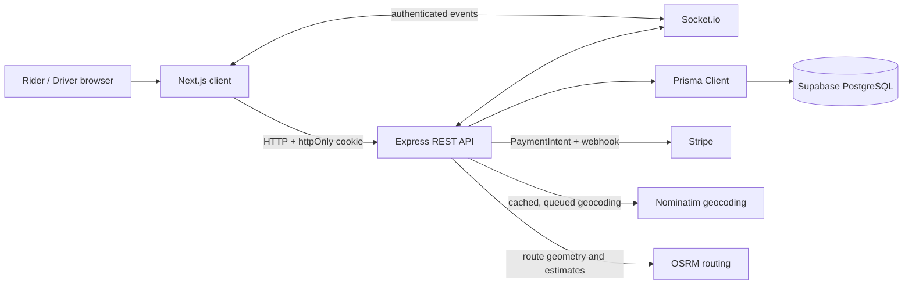
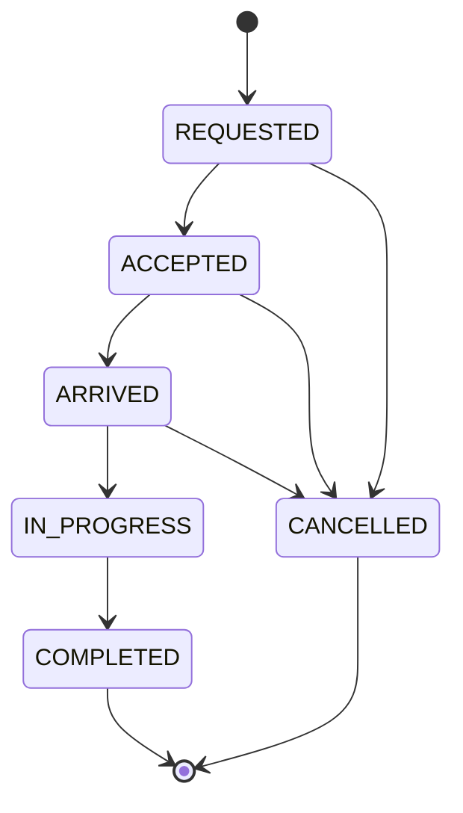

<div align="center">

<a href="https://readme-typing-svg.demolab.com">
  
</a>

<p><strong>A real-time ride-hailing experience built with Next.js, Express, Prisma, Socket.io, Stripe, and OpenStreetMap.</strong></p>

[](https://nextjs.org/)
[](https://www.typescriptlang.org/)
[](https://tailwindcss.com/)
[](https://expressjs.com/)
[](https://www.prisma.io/)
[](https://supabase.com/)
[](https://socket.io/)
[](https://stripe.com/)
[](https://leafletjs.com/)
[](./LICENSE)

<p><strong>Live demo:</strong> link coming soon</p>
<p><strong>LinkedIn video walkthrough:</strong> add the post link here after publishing</p>

</div>

## Overview

RideX is a full-stack ride-hailing demo for riders and drivers. Riders can search for places, estimate a route and fare, request a trip, follow ride status in real time, pay with Stripe, review their driver, and view a printable receipt. Drivers can go online, receive nearby ride requests, manage trip status, broadcast location, and view earnings.

The application is organized as an npm-workspaces monorepo: a Next.js App Router client and an Express API with Socket.io, Prisma, and PostgreSQL. Map searches and routing are requested through the API, which uses Nominatim and OSRM. Prices are calculated in integer paise; the app also displays USD conversions using a configured exchange-rate value.

> **Demo links:** Add the deployed app URL and LinkedIn walkthrough post URL above when they are available. For a guided demo, contact [Saurabh Pandey](mailto:developersaurabh001@gmail.com).

## Screenshots

Add captures to `docs/screenshots/` using the filenames below, then the table can be updated to embed the images.

| Surface | Screenshot placeholder |
| --- | --- |
| Landing page | `docs/screenshots/landing.png` |
| Rider booking and map | `docs/screenshots/booking.png` |
| Driver dashboard | `docs/screenshots/driver-dashboard.png` |
| Live ride and payment | `docs/screenshots/live-ride.png` |
| History and printable receipt | `docs/screenshots/history-receipt.png` |

## Features

### 🧍 Rider
- Cookie-based account registration and sign-in, with rider or driver roles.
- Place search, reverse geocoding, route preview, and fare estimates for four vehicle classes.
- Ride request, live status updates, driver details, and trip history.
- Stripe test-mode payment, post-payment driver review, and participant-only receipts.

### 🚘 Driver
- Online/offline status and location-based nearby requests.
- Race-safe ride acceptance, decline handling, and trip lifecycle actions.
- Earnings summaries and driver rating/profile details.
- Live location updates for an accepted ride.

### 🗺️ Platform
- Socket.io rooms and authenticated real-time events.
- Nominatim geocoding and OSRM routing proxied through Express.
- INR/USD display and Stripe payment currency selection.
- Responsive dark UI, accessible controls, skeletons, and printable receipt styling.

## Tech stack

| Area | Technology |
| --- | --- |
| Web application | Next.js 14 App Router, React 18, TypeScript |
| UI | Tailwind CSS, Radix primitives, shadcn-style components, lucide-react, Framer Motion |
| Client data and forms | Axios, Zustand, React Hook Form, Zod |
| Maps | Leaflet, React Leaflet, OpenStreetMap tiles, Nominatim, OSRM |
| API | Node.js, Express 4, TypeScript (ESM) |
| Real time | Socket.io |
| Persistence | PostgreSQL, Prisma |
| Payments | Stripe test-mode PaymentIntents and webhooks |
| Validation | Zod |

## Architecture



The Prisma datasource uses `DATABASE_URL` for pooled connections and `DIRECT_URL` for direct database operations such as migrations. Keep both values private.

## Ride lifecycle



## Repository structure

```text
ridex/
├── client/
│   ├── src/app/                 # App Router pages and route-level UI
│   ├── src/components/          # UI, layout, booking, ride, driver, and shared features
│   ├── src/hooks/               # Auth and currency hooks
│   ├── src/lib/                 # API, formatting, sockets, and utilities
│   ├── src/store/               # Zustand auth state
│   └── README.md
├── server/
│   ├── prisma/                  # Schema, migrations, and seed
│   ├── scripts/                 # API/socket/payment smoke test
│   ├── src/config/              # Environment, Prisma, and Stripe clients
│   ├── src/controllers/         # HTTP request handlers
│   ├── src/middlewares/         # Authentication, rate limits, and errors
│   ├── src/routes/              # REST route registration
│   ├── src/services/            # Business logic and integrations
│   ├── src/sockets/             # Socket.io server and event types
│   ├── src/validators/          # Zod schemas
│   └── README.md
├── .env.example                 # Server environment template
├── package.json                 # npm workspaces and root scripts
└── README.md
```

## Getting started

### Prerequisites

- Node.js 20 or newer and npm.
- A PostgreSQL database. Supabase is supported; local PostgreSQL also works.
- A Stripe test-mode secret key for payment and smoke-test flows.
- Network access to Nominatim and OSRM for geocoding and routing.

### Configure environment

Copy the root `.env.example` to `server/.env` and `client/.env.example` to `client/.env.local`. Set real database credentials and Stripe test keys in `server/.env`; do not commit secrets. Configure `CLIENT_URL` to the exact client origin used by the browser.

**Server** (`server/.env`):

| Variable | Required | Default / purpose |
| --- | --- | --- |
| `PORT` | No | `4000`; Express and Socket.io port |
| `NODE_ENV` | No | `development`; set `production` for production cookie security |
| `JWT_SECRET` | Yes in production | At least 32 random characters; development fallback is not accepted in production |
| `CLIENT_URL` | Yes for browser use | `http://localhost:3000`; exact CORS origin, credentials enabled |
| `DATABASE_URL` | Yes | PostgreSQL connection URL, usually the pooled Supabase URL |
| `DIRECT_URL` | Yes | Direct PostgreSQL URL used by Prisma migrations |
| `USD_INR_RATE` | No | `83`; conversion value used for displayed USD and USD payments |
| `NOMINATIM_BASE_URL` | No | `https://nominatim.openstreetmap.org` |
| `NOMINATIM_USER_AGENT` | Yes in production | Identifying User-Agent with a real contact email |
| `NOMINATIM_COUNTRYCODES` | No | Optional country-code filter, for example `in` |
| `OSRM_BASE_URL` | No | `https://router.project-osrm.org` |
| `STRIPE_SECRET_KEY` | Required for payments | Stripe test secret key, such as an `sk_test_...` key |
| `STRIPE_WEBHOOK_SECRET` | Yes in production | Test-mode signing secret from the configured webhook endpoint |

**Client** (`client/.env.local`):

| Variable | Required | Default / purpose |
| --- | --- | --- |
| `NEXT_PUBLIC_API_URL` | Yes on Vercel | `http://localhost:4000/api` is used only when developing locally; Socket.io removes the `/api` suffix. |
| `NEXT_PUBLIC_USD_INR_RATE` | No | `83`; client-side currency formatting conversion |
| `NEXT_PUBLIC_STRIPE_PUBLISHABLE_KEY` | Yes for card checkout | Stripe publishable test key, such as a `pk_test_...` key |

### Install, migrate, seed, and run

From the repository root:

```bash
npm install
```

From the `server/` directory, generate Prisma Client, create/apply the initial migration, and seed the test accounts:

```bash
npx prisma generate
npx prisma migrate dev --name init
npm run db:seed
```

Start the client and server together from the repository root:

```bash
npm run dev
```

The client defaults to `http://localhost:3000`; the API defaults to `http://localhost:4000`. Prisma Studio can be started from `server/` with `npx prisma studio`.

## Test credentials

The seed script upserts the following local test accounts. Both use `Password@123`.

| Role | Email | Password | Seeded details |
| --- | --- | --- | --- |
| Rider | `rider@example.com` | `Password@123` | Test Rider |
| Driver | `driver@example.com` | `Password@123` | Test Driver, CAB, Test Sedan, `TEST-001` |

The seeded driver starts **offline**. Set the driver online from the dashboard before testing nearby ride requests.

## API overview

All endpoints are under `/api`. Except the health check and Stripe webhook, the endpoints below require the authenticated `token` cookie. The API responds using `{ "success": boolean, "message": string, "data"?: ..., "errors"?: ... }`.

| Method | Path | Role | Description |
| --- | --- | --- | --- |
| `GET` | `/health` | Public | Readiness check; verifies the database connection |
| `POST` | `/auth/register` | Public | Create rider or driver account; sets auth cookie |
| `POST` | `/auth/login` | Public | Sign in; sets auth cookie |
| `POST` | `/auth/logout` | Public | Clear auth cookie |
| `GET` | `/auth/me` | Any signed-in user | Current profile |
| `PATCH` | `/auth/me` | Any signed-in user | Update profile and, for drivers, vehicle details |
| `GET` | `/maps/search?q=` | Any signed-in user | Search places through Nominatim |
| `GET` | `/maps/reverse?lat=&lng=` | Any signed-in user | Reverse-geocode coordinates |
| `POST` | `/maps/route` | Any signed-in user | Return OSRM route, distance, duration, and geometry |
| `POST` | `/rides/estimate` | Any signed-in user | Return route and fares for all vehicle types |
| `POST` | `/rides` | Rider | Create a ride; server recalculates route and fare |
| `GET` | `/rides/active` | Any signed-in user | Current active ride |
| `GET` | `/rides/history?page=&limit=&status=&from=&to=` | Any signed-in user | Paginated ride history with optional filters |
| `GET` | `/rides/:id` | Ride participant | Ride details |
| `POST` | `/rides/:id/accept` | Driver | Accept a requested ride atomically |
| `POST` | `/rides/:id/decline` | Driver | Decline a ride for this driver |
| `POST` | `/rides/:id/arrived` | Assigned driver | Mark driver arrived |
| `POST` | `/rides/:id/start` | Assigned driver | Start trip |
| `POST` | `/rides/:id/complete` | Assigned driver | Complete trip |
| `POST` | `/rides/:id/cancel` | Rider or assigned driver | Cancel before the trip starts; provide a reason |
| `GET` | `/driver/requests` | Driver | Nearby open requests; driver must be online |
| `POST` | `/driver/status` | Driver | Set online/offline state and current coordinates |
| `GET` | `/driver/earnings` | Driver | Today, week, all-time earnings, and trip counts |
| `POST` | `/payments/intent` | Rider | Create or resume a payment intent for a completed ride |
| `POST` | `/payments/confirm` | Rider | Confirm a Stripe payment server-side |
| `GET` | `/payments/:rideId` | Rider | Get payment for the rider's ride |
| `POST` | `/payments/webhook` | Public, Stripe signature required | Process signed Stripe webhook events |
| `POST` | `/reviews` | Rider | Review a completed, paid ride |
| `GET` | `/reviews/driver/:driverId` | Any signed-in user | Paginated driver reviews |
| `GET` | `/reviews/ride/:rideId` | Any signed-in user | Review for a ride |
| `GET` | `/receipts/:rideId` | Ride participant | Structured receipt |

Coordinate request bodies use `{ "pickup": { "lat": ..., "lng": ... }, "drop": { "lat": ..., "lng": ... } }`. Ride creation additionally requires `vehicleType` (`BIKE`, `AUTO`, `CAB`, or `PREMIUM`). Use the endpoint validators for exact input rules.

## Real-time events

Socket.io shares the API origin and authenticates using the `token` cookie. Authenticated users join `user:{id}`; online drivers join `drivers:online`; participants may join `ride:{id}`.

| Direction | Event | Payload / purpose |
| --- | --- | --- |
| Client → server | `ride:join` | `{ rideId }`; joins a ride room after participant check |
| Client → server | `ride:leave` | `{ rideId }`; leaves a ride room |
| Client → server | `driver:location` | `{ lat, lng, rideId? }`; driver location update, throttled to one per second server-side |
| Server → client | `ride:new` | New nearby ride request sent to online drivers |
| Server → client | `ride:accepted` | Accepted ride details |
| Server → client | `ride:status` | `{ ride, previousStatus }` for a transition |
| Server → client | `ride:cancelled` | Cancelled ride details |
| Server → client | `driver:location` | `{ driverId, lat, lng }` forwarded to the ride room |
| Server → client | `socket:error` | `{ message }` for socket validation/access/update errors |

## Payment testing

Use Stripe test-mode API keys only. The client payment form uses Stripe Elements; `server/scripts/smoke.ts` confirms a test PaymentIntent with Stripe's `pm_card_visa` test payment method, then checks that the driver's payout is credited. The configured test card for manual checkout is:

| Card number | Expiry | CVC |
| --- | --- | --- |
| `4242 4242 4242 4242` | Any future date | Any 3 digits |

Stripe amounts are sent in the selected currency's minor units. INR ride fares are stored in paise; the driver is credited 85% of the fare after successful payment. Configure a Stripe webhook endpoint for `/api/payments/webhook`; the handler requires a valid `Stripe-Signature`.

## Validation

```bash
npm run typecheck
npm run lint
npm run build
npm run smoke
```

The smoke test uses the configured database, Stripe test account, and external geocoding/routing services. It starts a temporary local HTTP server and exercises auth, maps, fares, ride lifecycle, Socket.io, payment, and review/receipt flows; it can create test records in the configured database.

## Manual deployment: Render API + Vercel client

These steps deploy RideX as a **public demo** using the free hosting tiers and Stripe test mode. This is not a production ride-hailing/payment operation: the default OSRM endpoint is a shared demo service, Stripe test mode does not collect real money, and the free providers have no uptime guarantees.

### 1. Create and prepare Supabase PostgreSQL

1. Create a Supabase project and keep its database password private.
2. In **Project Settings → Database → Connection string**, select the **Session pooler** (port `5432`) for the long-running Render API. Paste the complete URI into `DATABASE_URL`; URL-encode special characters in the password and retain `sslmode=require`.
3. Set `DIRECT_URL` to the Supabase direct connection string for Prisma migrations. If the direct host is unreachable from your network because of IPv4/IPv6 restrictions, use the Supabase **Session pooler** URI (port `5432`) for migrations instead. Do not use the transaction pooler (port `6543`) for migrations.
4. Do not run the known-password seed accounts on a public database. Register fresh demo accounts through the app instead.

Supabase may pause an inactive free project. The app checks database readiness and displays whether the API or database is unavailable, but an automatically or manually **paused** Supabase project may need to be resumed in the Supabase dashboard; repeated HTTP requests cannot resume every paused project.

### 2. Use same-site HTTPS domains for cookie authentication

The auth cookie is `httpOnly`, `Secure` in production, and `SameSite=Lax`. The default `*.vercel.app` and `*.onrender.com` addresses are different sites, so browsers can withhold this cookie on cross-site API and Socket.io requests. For a working production login, use HTTPS custom domains under the **same registrable domain**, for example:

- Client: `https://app.your-domain.com` on Vercel.
- API: `https://api.your-domain.com` on Render.

Add each hostname to its provider and follow the provider's DNS instructions. Wait until both HTTPS certificates are active. Keep the API and client as separate subdomains of the same domain; do not configure an API URL containing `/api` as the browser origin.

### 3. Apply database migrations

From the repository root on a trusted machine, set the production database URLs in the local shell (do not commit or share them), then apply the checked-in migrations:

```powershell
$env:DATABASE_URL = "<production session-pooler URL>"
$env:DIRECT_URL = "<production direct or session-pooler URL>"
npx prisma migrate deploy --schema=server/prisma/schema.prisma
Remove-Item Env:DATABASE_URL, Env:DIRECT_URL
```

Use `migrate deploy`, never `migrate dev`, against production. For later schema changes, run this migration step before routing traffic to code that requires the new schema. Render's free tier does not provide every paid deploy-hook feature, so this explicit migration step is compatible with the free setup.

### 4. Deploy the Express API to Render

1. In Render, choose **New → Web Service**, connect this GitHub repository, and set **Root Directory** to `.` (repository root).
2. Select the Node runtime and a free instance for a demo.
3. Set the build command to:

   ```text
   npm ci && npx prisma generate --schema=server/prisma/schema.prisma && npm run build --workspace @ridex/server
   ```

4. Set the start command to:

   ```text
   npm run start --workspace @ridex/server
   ```

5. Set the health check path to `/healthz`. This is a liveness check only, so Render will not restart the API just because Supabase is temporarily unavailable. The app's database readiness endpoint is `/api/health`.
6. Add these environment variables in Render's **Environment** settings (do not put secrets in source control):

   | Variable | Value |
   | --- | --- |
   | `NODE_ENV` | `production` |
   | `CLIENT_URL` | Exact Vercel origin, e.g. `https://app.your-domain.com` (no trailing slash or path) |
   | `JWT_SECRET` | A newly generated random secret of at least 32 characters |
   | `DATABASE_URL` | Supabase Session Pooler URI, port `5432` |
   | `DIRECT_URL` | Supabase direct URI or Session Pooler URI, port `5432` |
   | `USD_INR_RATE` | Current INR per USD value; keep the client value identical |
   | `NOMINATIM_USER_AGENT` | Identifying value with a real contact, e.g. `RideX/1.0 (contact: developersaurabh001@gmail.com)` |
   | `NOMINATIM_COUNTRYCODES` | `in` |
   | `STRIPE_SECRET_KEY` | Stripe test-mode `sk_test_...` key |
   | `STRIPE_WEBHOOK_SECRET` | Test-mode webhook signing secret (`whsec_...`) |

   Render supplies `PORT`; do not hard-code it. The server fails startup if required production settings are missing or unsafe.
7. Create a test-mode webhook in Stripe pointing to `https://api.your-domain.com/api/payments/webhook`, subscribe to `payment_intent.succeeded` and `payment_intent.payment_failed`, and copy its signing secret to Render. Keep the Stripe secret and publishable keys in the same mode.
8. Deploy and inspect Render logs. Verify `https://api.your-domain.com/healthz` returns `{"status":"ok"}` and `/api/health` returns HTTP 200 with `database: "available"`.

Render's free web service can sleep after inactivity. The landing page now requests `/api/health` immediately and shows a retrying status that distinguishes a waking API from an unavailable database. The first user action may still take longer; do not remove that status.

### 5. Deploy the Next.js client to Vercel

1. In Vercel, **Add New → Project**, import the same GitHub repository.
2. Set **Root Directory** to `client`. Keep the detected Next.js framework and default `npm run build` command. Vercel can use the repository's root npm workspace lockfile.
3. Add these variables for **Production** (and Preview only if its API/CORS/domain setup is also configured):

   | Variable | Value |
   | --- | --- |
   | `NEXT_PUBLIC_API_URL` | `https://api.your-domain.com/api` |
   | `NEXT_PUBLIC_USD_INR_RATE` | Same value as Render's `USD_INR_RATE` |
   | `NEXT_PUBLIC_STRIPE_PUBLISHABLE_KEY` | Stripe test-mode `pk_test_...` key |

   `NEXT_PUBLIC_*` values are public and baked into the client build. Never put a Stripe secret or database credential in Vercel.
4. Add `app.your-domain.com` to the Vercel project and configure its DNS as Vercel instructs. Set Render's `CLIENT_URL` to this exact production origin.
5. Redeploy Vercel after setting the environment variables. If you later change `NEXT_PUBLIC_API_URL`, trigger a new Vercel build.

### 6. Verify the deployed demo

1. Open the client and wait for the landing-page status to say services are ready. If it reports the database unavailable, check `/api/health`, then resume the Supabase project if it is paused.
2. Register a rider and a separate driver with the same vehicle class. Give the browser location permission, or enter the driver's current coordinates manually.
3. Set the driver online **near the rider's pickup**. Requests only appear for online drivers whose registered vehicle matches and whose current location is within 15 km of the pickup. Use the driver's Refresh button to check immediately; the dashboard also refreshes after socket reconnect and every 10 seconds.
4. Create a rider booking and check the driver's dashboard. If it does not appear, verify online status, vehicle type, both coordinates, pickup radius, and `/api/health`; the empty state explains the matching rules.
5. Complete the ride and use Stripe's test card `4242 4242 4242 4242` with any future expiry and CVC. Test mode only; do not use real card details.
6. Test logout/login, history, reviews, receipts, and socket reconnect. Verify the auth cookie is present in browser storage for the API's custom domain and that API requests include credentials.

### Free-tier limitations

- Render cold starts and Supabase pauses can delay availability; a paused database may require manual resume.
- Nominatim and the default public OSRM server are shared services with usage limits and no production SLA. Use a contracted geocoding/routing provider or self-hosted service before a real public launch.
- Stripe is intentionally restricted by this codebase to test mode. Do not accept real payments or treat the local driver-earnings ledger as money transfer.
- The app has a single API instance and in-memory caches/declines; these are suitable for a demo, not horizontal scaling or durable dispatch.

## Roadmap

- Replace the demo and LinkedIn video placeholders with published project links.
- Add deployment-specific operational monitoring and production-grade routing infrastructure.
- Add automated component and end-to-end browser test suites.

## Contributing

1. Fork the repository and create a focused branch.
2. Install dependencies with `npm install`.
3. Configure local client, server, PostgreSQL, and Stripe test environments.
4. Make a focused change and run typecheck, lint, build, and relevant smoke tests.
5. Open a pull request with a clear description and screenshots for UI changes.

Please do not include secrets, real customer data, or production payment information in issues, logs, or pull requests.

## License

Distributed under the [MIT License](./LICENSE).

## Author

**Saurabh Pandey**  
[LinkedIn](https://www.linkedin.com/in/saurabhpandey-/) · [GitHub](https://github.com/SaurabhPandey016) · [Email](mailto:developersaurabh001@gmail.com)

<div align="center">

Made with ❤️ by [Saurabh Pandey](https://www.linkedin.com/in/saurabhpandey-/)

</div>
